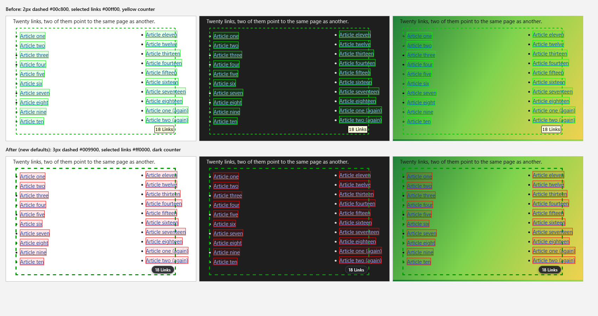
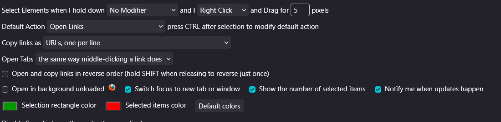

Adds a choice of colors for selecting, and makes the default look easier to see.

- Two color pickers on the options page, **Selection rectangle color** and **Selected items color**, and a **Default colors** button. Both colors are read at each drag, so a new color applies without reloading the open pages.
- New defaults, picked for contrast on light and dark pages (WCAG contrast ratio; 3:1 is the usual minimum for lines and shapes):
  - Selection rectangle: `#00c800` 2px → `#009900` **3px**. Contrast 2.3:1 → 3.8:1 on white, 4.4:1 on a dark page. A dashed line paints only about half its length, hence the extra pixel; the clip margin at the document edge (`Expand(-3, -3)`) follows the line width.
  - Selected items: `#00ff00` → `#ff0000`. Contrast 1.4:1 → 4.0:1 on white, 4.2:1 on dark. **This one is a proposal**: if you would rather keep green, it is one line in `DefaultPrefs`.
- The selection counter is a dark pill instead of the pale yellow box.

### Questions

1. Red as the default for selected items, or keep green?
2. Should the counter get its own color setting too, or follow the selection rectangle color? Happy to add either to this PR.

Feel free to push changes to the branch yourself, or tell me what you would like and I will do it.

### Notes

- `HighlightStyles_ActOnElements` now holds only `fill-opacity` and `stroke-width`; the colors come from `HighlightColor`. No version ever wrote that preference to storage and no options page ever showed it (checked back to the old `Configs` class), so only a value set by hand from the console would keep its old colors. No migration added for that.
- The colors are only written by `<input type="color">`, which always gives `#rrggbb`.
- `History.md` is left for the release, as with the earlier PRs.

### Testing

- New tests: the pickers show the defaults, a picked color is saved, **Default colors** puts both defaults back and saves them; the rectangle takes `SelectionRectColor` at every `DragStarted` (also after a change); the outline is 3px dashed; the highlight style uses `HighlightColor`, also after a change; the clip margin is 3px. `npm test`: 481 passed. `npm run lint`: clean. `web-ext lint`: unchanged (the one existing `innerHTML` warning in `Utility.js`).
- By hand in Firefox (`run-ff`) on light, dark and busy pages, and the options page in the dark theme. Not tried by hand in Chrome or Edge.
- Reviewed before opening by two AI reviewers working independently; their findings were checked against the code, and the tests were tightened where they had a point.

🤖 Generated with [Claude Code](https://claude.com/claude-code)

